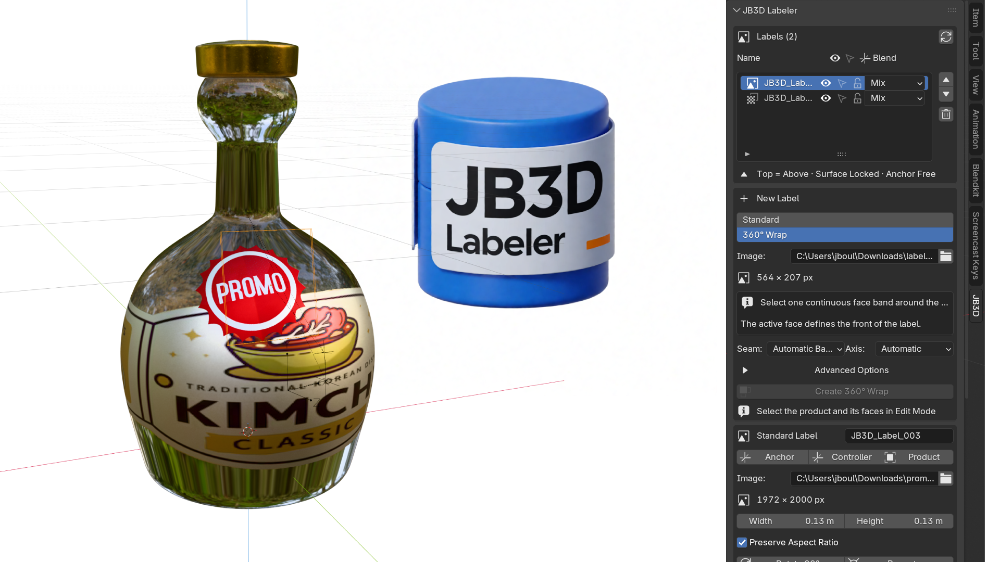
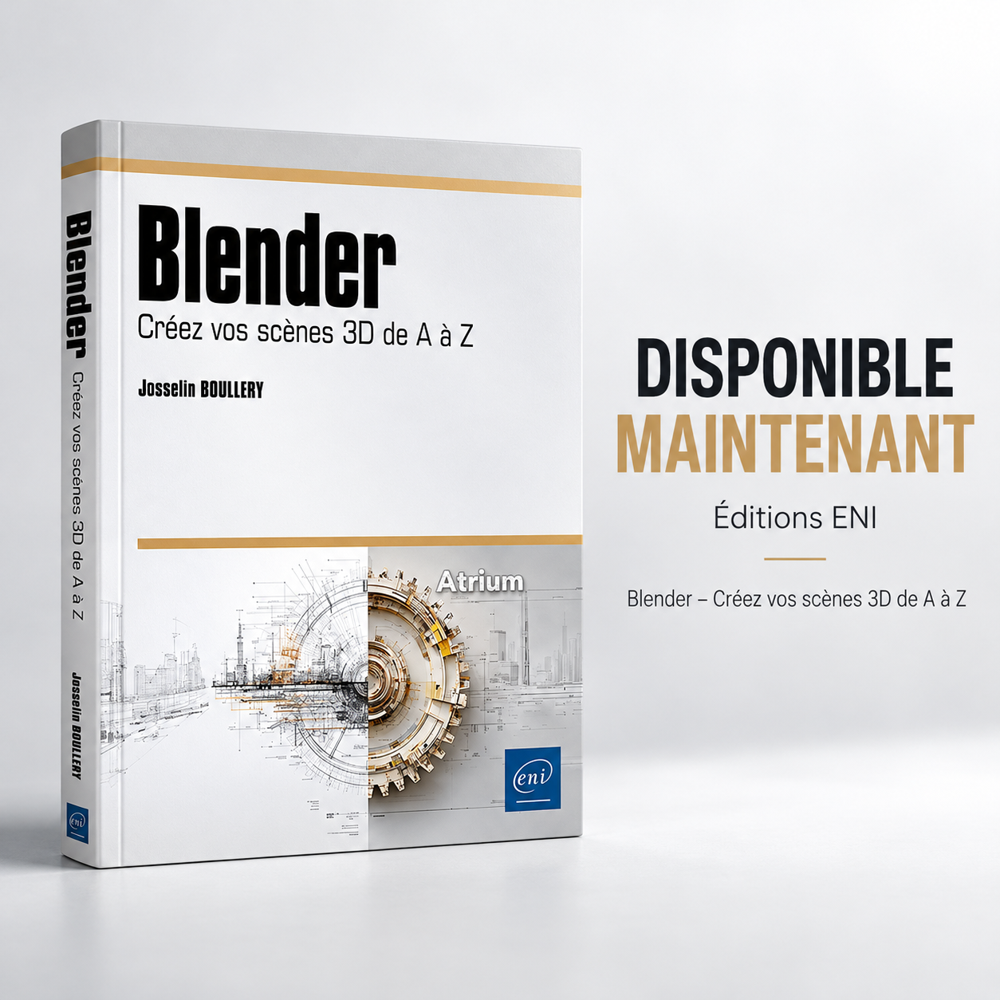

# JB3D Labeler

**Create realistic product labels and 360° wraps in Blender. Easily, precisely, and non-destructively.**

JB3D Labeler is a free, open-source Blender add-on designed to simplify label creation for 3D product visualization.

Whether you're working on cosmetic packaging, bottles, jars, cans, or product mockups, JB3D Labeler lets you place, customize, and manage labels directly on your 3D models without manually building complex UV setups.

The goal is simple: **spend less time setting up labels and more time creating great product visuals.**

[**Get JB3D Labeler — Free on Blender Extensions**](https://extensions.blender.org/add-ons/jb3d-labeler/)

---

## What can you do with JB3D Labeler?

### Standard Labels

Place labels on selected areas of your 3D model.

Select the desired faces, import your artwork, define its dimensions, and let JB3D Labeler handle the placement.

Your labels remain editable, so you can adjust their position, rotation, scale, opacity, and appearance whenever needed.

### 360° Wrap Labels

Create continuous labels around bottles, cans, jars, and other cylindrical or slightly tapered products.

JB3D Labeler automatically handles wrap orientation, seam placement, and UV mapping based on your selected geometry.

Perfect for full packaging designs and realistic product presentations.

### Layered Label System

Combine multiple labels on a single product.

Create main packaging artwork, secondary labels, promotional stickers, or decorative elements, each with independent controls.

Adjust stacking order, visibility, opacity, and blending modes directly from the label manager.

### Advanced Material Effects

Go beyond simple printed images.

JB3D Labeler integrates labels into your product's material system, allowing you to create more realistic packaging effects.

Features include:

- Selective roughness and metallic effects.
- Label blending and opacity controls.
- ColorRamp-based masks.
- Masked color replacement and tinting.
- Support for PBR texture packs.
- Automatic texture map detection.
- Normal and bump mapping.
- Displacement workflows for Eevee and Cycles.
- Compatibility with glass and transparent materials.
- Support for products using Solidify modifiers.

All while keeping your original product material and label placement editable.

---

## Getting started

### Installation

JB3D Labeler is available for free through the official Blender Extensions platform.

1. Open Blender.
2. Go to **Edit → Preferences → Get Extensions**.
3. Search for **JB3D Labeler**.
4. Install and enable the extension.

You can also download it directly from the official extension page.

[Download JB3D Labeler](https://extensions.blender.org/add-ons/jb3d-labeler/)

### Creating your first label

1. Select your product in Blender.
2. Enter Edit Mode and select the faces where your artwork should appear.
3. Open JB3D Labeler.
4. Choose between Standard Label and 360° Wrap.
5. Import your label image.
6. Adjust the dimensions and create your label.

You can then fine-tune its placement, appearance, materials, and layer order.

**Tip:** For 360° wraps, select one continuous band of quad faces around your product.

---

## Who is it for?

JB3D Labeler was created with real product visualization workflows in mind.

It's particularly useful for:

- Product visualization artists.
- Packaging and graphic designers.
- Cosmetic and beauty product presentations.
- Food and beverage packaging.
- E-commerce product rendering.
- Blender artists creating realistic product mockups.

Whether you're developing a single product or exploring several packaging concepts, JB3D Labeler helps keep the process flexible and efficient.

---

## Free and open source

JB3D Labeler is completely free.

The add-on is distributed under the **GPL-3.0-or-later** license.

No subscription, no paid features, and no restrictions designed to push you toward a commercial version.

If you find it useful, consider sharing it with other Blender artists.

Your feedback also helps make the add-on better.

[Report a bug or suggest a feature](https://github.com/jb3dformations/JB3DLabeler/issues)

---

## About the creator

I'm Josselin Boullery, a French 3D artist, Blender instructor, and author.

I work with Blender for product visualization, creative projects, and professional training.

I created JB3D Labeler to simplify a workflow I regularly encounter when working with 3D products: placing and managing packaging artwork without spending unnecessary time on technical setup.

The add-on was developed with the help of AI-assisted coding, combining practical 3D experience with an iterative development approach.

I hope it makes your own Blender projects a little easier.

---

## Pour aller plus loin avec Blender

  

### Blender — Créez vos scènes 3D de A à Z

**Un livre de Josselin Boullery, publié aux Éditions ENI.**

Vous utilisez JB3D Labeler et vous aimeriez approfondir votre maîtrise de Blender ?

J'ai également écrit un ouvrage de 570 pages pour accompagner les artistes 3D dans leur apprentissage de Blender, depuis les fondamentaux jusqu'à la réalisation de scènes complètes.

Au programme : modélisation, matériaux, textures, UV Mapping, éclairage, rendu avec Cycles et Eevee, animation, Geometry Nodes, simulations, compositing et bien plus encore.

L'approche est progressive, avec des explications concrètes et des projets pratiques issus de mon expérience de formateur Blender.

Le livre est basé sur Blender 4.5 LTS et aborde également les nouveautés de Blender 5.

**Disponible en français, aux formats papier et numérique.**

[**Découvrir le livre sur le site des Éditions ENI**](https://www.editions-eni.fr/livre/blender-creez-vos-scenes-3d-de-a-a-z-9782409055560)

---

*Thank you for using JB3D Labeler and supporting independent Blender tools!* 
